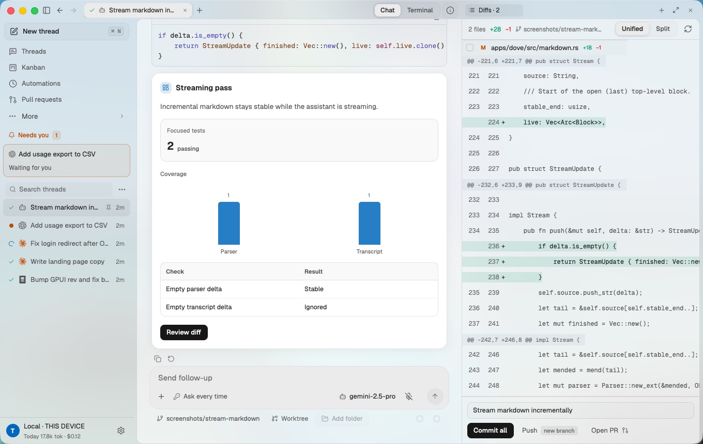
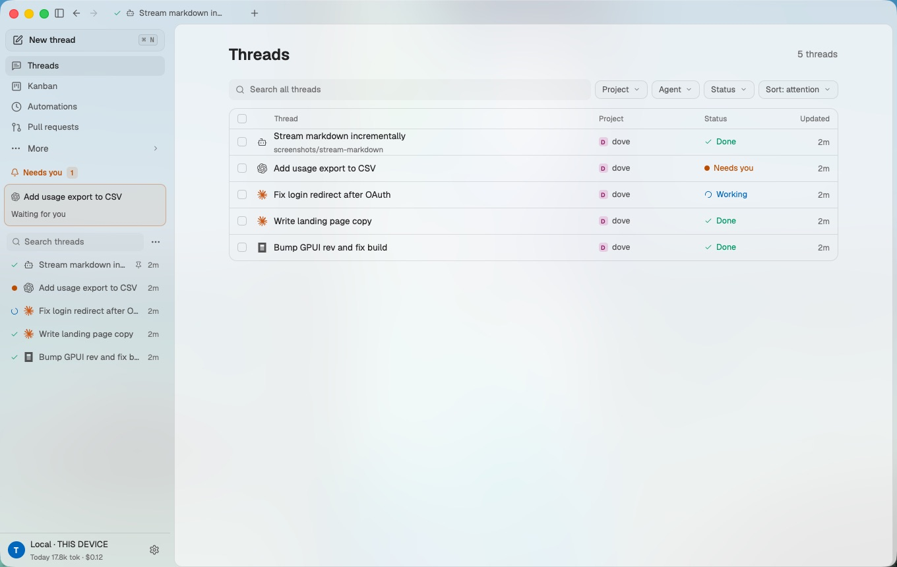
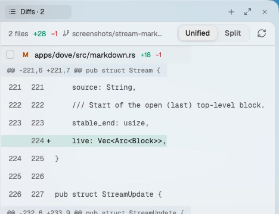

<p align="center"></p>

<h1 align="center">Keplorayx</h1>

<p align="center"><b>The agentic development environment.</b><br>Many coding agents, one native window. Worktrees, diffs, browser control and your phone as a remote.</p>

<p align="center"><a href="#install">Install</a> · <a href="#features">Features</a> · <a href="ARCHITECTURE.md">Architecture</a> · <a href="#supported-agents">Agents</a> · <a href="CONTRIBUTING.md">Contributing</a></p>



## What Keplorayx is

Keplorayx is a native desktop app for working with coding agents. It runs Claude Code, Codex, Cursor, Gemini CLI, OpenCode, Devin and more side by side. Each task gets its own git worktree, a live transcript, a diff to review, an in-app browser the agent can drive, and a usage ledger that stays in one place whichever agent did the work.

Keplorayx is written in Rust on [GPUI](https://github.com/zeronsh/zui). There is no Electron shell and no embedded web app for the product itself. It is local-first: your data lives in `~/.dove`, and agents run on your own subscriptions and API keys.

## Features

- **Many agents, one window.** Threads from every agent share the same projects, review tools and attention-sorted sidebar (needs you, working, unread, failed).
- **Team and orchestration.** Teammates with a name, a role, a brief and notes they keep, on any agent and model. Any thread can hand work to any agent or teammate (in its folder or its own worktree), message teammates, and read, steer, wait on or stop other threads; results come back on their own as one batched update. Children never get broader permissions than their parent. Details: [docs/TEAM.md](docs/TEAM.md).
- **Worktrees by default.** A task can run on its own branch so two agents can edit the same repo without overwriting each other. Commit, push, open and merge PRs from the thread.
- **Chat ⇄ terminal.** Chat is the rich view: approvals, steering, queued messages, usage. Terminal hands the same session to the agent's own TUI and mirrors it back.
- **Side panel.** Diffs, git history, a file viewer and editor, an in-app browser, a terminal and a side chat stay attached to each thread. `path:line` links open in place.
- **Browser control.** Every agent gets Keplorayx's browser tools over MCP (`browser_navigate`, `browser_snapshot`, `browser_click`, `browser_type`, `browser_press`, `browser_scroll`, `browser_screenshot`). Drive the in-app browser or your own Chrome through the extension.
- **Generative UI.** Agents can answer with interactive cards (` ```ui ` fences or the `show_ui` tool): stats, charts, tables, checklists, toggles, choices. The user's pick returns as a normal message, so every harness can continue.
- **Office documents.** Create, preview and edit PDF, PPTX, XLSX and DOCX files in the side panel.
- **Integrations.** Paper design canvases, Composio apps (GitHub, Linear, Slack, Notion and more, with your own key) and desktop computer use (one `computer` tool on the open-source cua-driver: background input, approvals in the thread, Take over), all injected through the same MCP server.
- **Dictation.** Hold the mic in the composer or terminal to talk; the text is inserted, never sent. Speech to text runs on your machine with NVIDIA Parakeet, downloaded on demand from Settings › Voice.
- **Voice Mode.** A hands-free call with all your agents: ask "what's happening?", "tell Codex to also run clippy", "stop", "approve", "talk to the tests thread", "start a Claude task on the login page in a new worktree". Listening, turn detection and speech recognition run on your machine (Moonshine or Parakeet, Silero VAD, Smart Turn); Keplorayx speaks with your system's voice and you can talk over it. Voice never approves deletions, force pushes or work outside a thread's folder.
- **Keplorayx for Chrome.** A browser extension that lets agents work in your own browser, on sites you allow, with a review window before anything that submits, buys, sends or deletes, and a Stop that takes effect immediately.
- **Faster first reply.** Keplorayx starts Claude Code while you type (process, settings and MCP servers) and hands it your message on send: 11.35 s → 2.87 s to first text in a local measurement.
- **Mobile remote.** iOS and Android apps signed in with your Woozlit account show live transcripts and let you approve, steer and start runs. The agent keeps running on your desktop.
- **Your own backdrop.** Put any image behind the new-thread page through Original, Dither, Halftone or Scanlines. Turn on **Animate backdrop** and each effect gets its own motion worked out from the image: a slow push, an aircraft with light trails crossing a Bayer-dithered scene, rippling halftone dots, or a rolling CRT scan.
- **A transcript that reads like a document.** Markdown, tables, Mermaid, math and images render incrementally while tokens stream. Tool calls fold.

| Threads | Side panel |
| --- | --- |
|  |  |

## Install

Download the latest beta from [GitHub Releases](https://github.com/PupppyLoverr/Dove/releases): `Dove-Setup-<version>.exe` or the portable zip for Windows, the `.dmg` for macOS (Apple Silicon), and the `.deb`, AppImage or tarball for Linux (glibc 2.38+: Ubuntu 24.04, Debian 13 or newer). The beta is not code-signed yet: on Windows choose **More info → Run anyway** at the SmartScreen prompt, and on macOS right-click Keplorayx → **Open** the first time. Feedback, bugs and feature requests: [the beta form](https://form.typeform.com/to/LeOHrZiR).

Keplorayx drives agent CLIs you install yourself. Install at least one, for example:

```sh
npm i -g @anthropic-ai/claude-code   # Claude Code
npm i -g @openai/codex               # Codex
npm i -g @google/gemini-cli          # Gemini CLI
```

Sign in to each CLI once in a terminal the way you normally would. Keplorayx picks up its credentials.

## Build from source

Requires Rust stable 1.90 or newer.

```sh
git clone https://github.com/PupppyLoverr/Dove
cd Keplorayx
cargo run -p dove                 # or: cargo run -p dove -- path/to/repo
CARGO_INCREMENTAL=0 cargo build -p dove --release
```

The release `Keplorayx.app` is 91 MB: `dove` is 80 MB and the `dove-mesh-host` remote-control sidecar is 9.3 MB. Both are built with LTO and stripped.

Linux system dependencies:

```sh
sudo apt-get install -y libxkbcommon-dev libxkbcommon-x11-dev libwayland-dev libvulkan-dev libx11-xcb-dev libxcb1-dev libfontconfig-dev libssl-dev pkg-config
```

Data and logging:

- Data lives in `~/.dove`. Override it with `DOVE_HOME`.
- Verbose logs: `DOVE_LOG=debug`.
- The first launch plays a short intro (click or Esc to skip). `DOVE_SKIP_INTRO=1` turns it off; `DOVE_SHOW_INTRO=1` replays it. Its assets are in [`media/intro`](media/intro/README.md).

## Architecture

```text
apps/dove            GPUI window: sidebar, threads, composer, transcript, side panel, browser
apps/landing         Static website
crates/dove-core     Engine: runtime, live sessions, task lifecycle, automations
crates/dove-harness  Agent adapters: one AgentEvent stream from every CLI
crates/dove-proto    Shared types: events, tools, permissions, usage
crates/dove-store    SQLite + JSONL transcripts
crates/dove-git      Worktrees, status, diffs, history, PRs
crates/dove-term     Terminal emulator and PTY sessions
```

The UI never writes session activity itself. It watches `LiveSession` events and sends commands; the engine appends each event to the transcript, updates status and usage, then forwards it. Agents enter through one harness boundary, and Keplorayx's extra tools reach every agent through one injected MCP server. [ARCHITECTURE.md](ARCHITECTURE.md) covers the data flow, the browser control path, the store and the desktop ⇄ edge ⇄ mobile sync.

## Supported agents

| Agent | Integration |
| --- | --- |
| Claude Code | stream-json |
| Codex | app-server JSON-RPC |
| Cursor | Zeron driver |
| OpenCode | Zeron driver |
| Devin | Zeron driver |
| Grok Build | Zeron driver |
| Pi, Hermes, Antigravity | Zeron driver |
| Gemini CLI | ACP |
| Copilot | ACP |
| Qwen Code | ACP |
| goose | ACP |
| Factory Droid | ACP |
| Amp, Cline, Kimi | ACP |
| Kilo | OpenCode driver |

Model lists refresh from each CLI's live catalog when it answers.

## Mobile apps

The iOS app (`apps/ios`) and the Android app (`apps/android`) are remote controls for the desktop. To turn it on, open **Settings › Remote control** on the desktop, click **Sign in with Woozlit**, and sign in on the phone with the same account. The desktop publishes each session as a Loro CRDT document to the Cosmos edge (Cloudflare Workers + Durable Objects). The phone shows it live and sends commands back: send, steer, interrupt, approve and answer. When remote control is off, nothing leaves the machine. Code and files always stay on your machine.

## Dictation and Voice Mode

Speech to text is optional and is not inside the Keplorayx binary. **Parakeet** (NVIDIA Parakeet TDT 0.6B v3, the model Zeron uses) downloads on demand from Settings › Voice into `~/.dove/voice` and runs entirely on your machine.

**Voice Mode** is a call: click the phone button beside the mic (or press Ctrl/Cmd+Shift+Space; on Windows it works from any app) and talk. Download its models once in Settings › Voice › Voice Mode models: Moonshine (66 MB, fast) or use Parakeet (more accurate, more memory), Silero VAD (2 MB) and Smart Turn (9 MB). Everything runs locally; cloud speech (an OpenAI-compatible endpoint, Deepgram or ElevenLabs) is off unless you turn it on, and Settings says what it would upload. "Take a look at this" attaches the open page, the diff, or (Windows) the window you were just in. Hold the orb (or Space) to talk while muted; talk over Keplorayx to interrupt it. Measured on a 2020 laptop (i7-10810U, Windows 11): listening-ready in 1.4–1.8 s from cold, about 160 MB of memory while a call runs, under 1% of a core while you are silent, playback stops within 9 ms of you interrupting. Details and the targets it does not meet yet: [docs/VOICE.md](docs/VOICE.md).

## Keplorayx for Chrome

`apps/extension` is a Manifest V3 extension for Chrome, Edge and Brave. Load it unpacked, open its side panel and paste the pairing code from Settings › Plugins. Agents then get `chrome_*` tools for your own browser, only on sites you allow, with a review window before consequential actions. See [apps/extension/README.md](apps/extension/README.md).

## Keyboard shortcuts

| Action | Shortcut |
| --- | --- |
| New session | Ctrl/Cmd+N |
| Add project | Ctrl/Cmd+O |
| Toggle sidebar | Ctrl/Cmd+B |
| Toggle side panel | Ctrl/Cmd+\ |
| Toggle terminal | Ctrl+` |
| Back / forward | Alt+Left / Alt+Right |
| Settings | Ctrl/Cmd+, |
| Start or end a voice call | Ctrl/Cmd+Shift+Space |
| Send message | Enter |
| Insert newline | Shift+Enter |
| Terminal copy / paste | Ctrl+Shift+C / Ctrl+Shift+V |

## Website

The landing page lives in [`apps/landing`](apps/landing/README.md): plain HTML, CSS and JS with no build step, deployable for free to Cloudflare Pages or GitHub Pages.

## Contributing

Issues and pull requests are welcome. Start with [CONTRIBUTING.md](CONTRIBUTING.md).

## License

Apache-2.0. See [LICENSE](LICENSE). Third-party notices (Zeron, zui, gpui-component, Inter, JetBrains Mono) are in [THIRD_PARTY_NOTICES.md](THIRD_PARTY_NOTICES.md).
